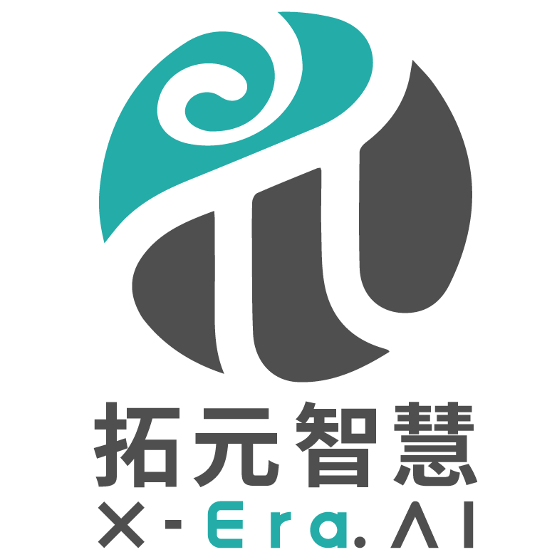

<div align="center">
  
  <h3>Recursive Self-Improvement Infrastructure for Physical Agents</h3>
  <p>
    <a href="https://arxiv.org/abs/2607.16636">Technical Report</a> ·
    <a href="https://phy-agent-os.net/">Website</a> ·
    <a href="docs/README.md">Documentation</a> ·
    <a href="https://discord.gg/YJztZ4wUM">Discord</a>
  </p>
  <p>
    <a href="LICENSE"></a>
    
    <a href="CHANGELOG.md"></a>
    <a href="https://github.com/PhyAgentOS/PhyAgentOS-core/stargazers"></a>
  </p>
  <p><a href="README.md">English</a> · <a href="README_zh.md">简体中文</a></p>
  <p>
    <a href="#what">What</a> ·
    <a href="#why">Why</a> ·
    <a href="#release">v1.1.0</a> ·
    <a href="#quick-start">Install</a> ·
    <a href="#control-modes">Control Modes</a> ·
    <a href="#simulation-quickstart">Quickstart</a> ·
    <a href="#quickstart-examples">Examples</a> ·
    <a href="#documentation">Documentation</a>
  </p>
  <p><a href="docs/news/gosim-shenzhen-2026.md"><b>GOSIM Shenzhen 2026 Spotlight · October 16–17 · Meet us in Shenzhen</b></a></p>
</div>

---

<a id="what"></a>
## What is PhyAgentOS?

**PhyAgentOS is a Recursive Self-Improvement (RSI) framework for embodied agents.** It connects cognitive planning, Physical Execution, and task verification in a runtime-wide feedback loop, improving Skills and Lessons from verified experience for future tasks.


<a id="why"></a>
## Why PhyAgentOS?

| Capability | What it enables |
| --- | --- |
| **One framework, multiple control modes** | Combine general-model reasoning, action models, or hybrid control through the capabilities exposed by an installed Skill. |
| **Verified task outcomes** | Evaluate goals against observations and execution facts, with bounded replanning when recovery is needed. |
| **Experience that improves future tasks** | Accumulate reusable workflows and scoped Lessons from verified experience, with guarded promotion and revision history. |
| **Reusable physical capabilities** | Package environment-specific tools and runtimes as versioned Skills, keeping cognitive planning separate from robot integration. |

<a id="release"></a>
## What's new in v1.1.0

**Provider management, Skill Runtime and governed interactions.** This release adds:

- **Provider management:** centralized configuration, connection tests, authentication, model discovery, saved model selection, and per-session overrides.
- **More model connections:** direct OpenAI Responses API support for tools, multimodal input, reasoning effort, and Forge verification; Requesty, Cheaper Inference, and API Route gateways.
- **Skill Runtime updates:** `directory_tar_gz` Node packages with bundled dependencies and validated internal relative symbolic links; profile startup timeouts, `required_tools` overrides, and startup-hook context for LIBERO 0.3.4.
- **Governed interaction foundation (opt-in):** connect AgentTask and Session to multi-step decisions, independent root verification, and one deduplicated experience episode through frozen bindings, a persistent Runner, and a Supervisor. See [scope and enablement](docs/interaction/README.md).
- **Reliability improvements:** preserve valid cron jobs, handle Dora status and profile environments, improve archive and image-path handling, and retain conversation history on model failures. Cancellation blocks new execution intents, late decisions are discarded, and uncertain operations retain guards until reconciliation without automatic retransmission.
- **Guides and validation:** expanded regression and build checks, bilingual documentation, Piper and LIBERO-10 quickstarts, and clearer benchmark scope and results.

See the [full changelog](CHANGELOG.md) and [changes since v1.0.0](https://github.com/PhyAgentOS/PhyAgentOS-core/compare/v1.0.0...v1.1.0).

<a id="quick-start"></a>
## Install and configure

Start with a model-backed CLI conversation, then follow the [MuJoCo Quickstart](#simulation-quickstart) below. **Prerequisites:** Python 3.11 or 3.12, Git, and an API key for your model provider.

### 1. Install and initialize

```bash
git clone --branch v1.1.0 https://github.com/PhyAgentOS/PhyAgentOS-core.git
cd PhyAgentOS-core
python -m venv .venv
source .venv/bin/activate
python -m pip install -e .
paos onboard
```

On Windows PowerShell, replace the activation command with `.venv\Scripts\Activate.ps1`.

### 2. Connect a model


Configure credentials with hidden input, then select the default:

```bash
paos provider configure openrouter
paos provider use openrouter --model anthropic/claude-sonnet-4
```

See the [provider CLI guide](docs/en/02-user-manual.md#2-configure-the-model-and-forge) for
Docker/secret input, process overrides and session commands (`/provider`, `/model`, `/effort`, `/status`).
Session switches affect subsequent turns only and leave running tasks and other sessions unchanged.

<details>
<summary>Full configuration reference (v1.1.0)</summary>

The configuration file is serialized in camelCase; snake_case keys are also accepted.

```json
{
  "agents": {
    "defaults": {
      "workspace": "~/.PhyAgentOS/workspace",
      "model": "openrouter/openai/gpt-4o-mini",
      "provider": "openrouter"
    },
    "verification": {
      "serviceEnabled": true,
      "evidenceRetention": "failed",
      "maxReplansPerEpisode": 2,
      "maxVerifierCallsPerRun": 50
    },
    "evolution": {
      "enabled": true,
      "scope": "verified_forge_lineage",
      "promotionMode": "guarded_auto",
      "minSuccessfulEpisodes": 3,
      "minLessonEpisodes": 3,
      "maxLessonsPerSkill": 8,
      "maxEvolutionCallsPerRun": 20
    }
  },
  "providers": {
    "openrouter": {
      "apiKey": "YOUR_API_KEY"
    }
  },
  "forge": {
    "requestTimeoutS": 10,
    "pollIntervalS": 0.5,
    "executionTimeoutS": 300,
    "evidence": {
      "requiredImageSources": ["front"],
      "captureTimeoutS": 5,
      "postCaptureTimeoutS": 5,
      "connectionTimeoutS": 2,
      "maxArtifactBytes": 8388608,
      "associationQuality": "best_effort"
    }
  },
  "resourceRegistry": {
    "url": "https://paos-resource-manager.dev.x-era.com"
  }
}
```

The `front` source is only an example. `resourceRegistry.url` selects a generic package registry;
it may be empty when all artifacts are installed from local bundles or a supplied static index.
PAOS connects only to the Gateway URL in the manifest of the explicitly started, healthy Skill
Runtime. It never starts or downloads a concrete Skill merely because the Agent starts.

</details>

### 3. Run your first request

```bash
paos status
paos agent -m "Hello! Introduce yourself."
paos agent
```

You should receive a model response; `paos agent` opens an interactive conversation. This checks the core Agent and provider connection. Physical execution additionally needs a running Skill Runtime.

Need another provider or deployment option? See the [user manual](docs/en/02-user-manual.md) · [Docker](docs/user_manual/DOCKER.md).

<a id="control-modes"></a>
## One framework, three control modes


System 1 / System 2 follow the supplied figure’s naming for general-model control and action-model control, respectively.

These describe integration patterns; model and environment availability depends on the installed Physical Execution Skill. Core does not bundle model weights, simulator assets, or robot drivers.

<a id="robot-skills"></a>
<a id="simulation-quickstart"></a>
## Quickstart · Control a robot in MuJoCo

Use **`robot-control-sim`** to control a simulated Piper arm through joint targets or
end-effector poses. Complete the installation and model configuration above first.
The prebuilt simulation Nodes used here target **Linux x86_64** and require a working
graphical display or virtual display for MuJoCo and the image viewer.

### 1. Install Dora

v1.1.0 retains the Dora CLI **0.4.1** (`dora-message` **0.7.0**) compatibility baseline:

```bash
curl --proto '=https' --tlsv1.2 -LsSf \
  https://github.com/dora-rs/dora/releases/download/v0.4.1/dora-cli-installer.sh | sh
dora --version
```

Dora is required to start the simulation Runtime. See the [Dora installation reference](docs/en/02-user-manual.md#dora-cli-for-managed-skill-profiles) for other installation methods.

### 2. Install robot-control-sim

Set `resourceRegistry.url` in your config, or `PAOS_RESOURCE_REGISTRY_URL`, to a deployment
that provides `robot-control-sim` and its locked Node artifacts. Then run:

```bash
paos skill search robot-control-sim
paos skill install robot-control-sim
paos skill inspect robot-control-sim
```

`inspect` shows the installed version, profiles and dependencies. This example uses
`mujoco-piper`; `mujoco-franka` and `mujoco-so101` select other robots. For a separately
obtained Bundle, use `paos skill install /path/to/robot-control-sim.tar.gz --local`;
its locked Nodes must also be available. Core does not bundle these simulation assets.

### 3. Start the simulation

```bash
paos skill start robot-control-sim --profile mujoco-piper
paos skill status robot-control-sim
```

Wait for the Runtime to report healthy and the simulation camera viewer to open. If startup
fails, inspect `paos skill logs robot-control-sim` before sending a motion request.

### 4. Control joints and the end effector

The Agent first reads `sim.get_robot_info` and live Tool context to determine joints, limits,
frames and units. It then uses the active Skill's workflow to execute and reconcile the motion.

| Control mode | Tool | Target |
| --- | --- | --- |
| Joint targets | `sim.set_joint_positions` | Absolute arm joint positions in radians |
| End-effector pose | `sim.move_eef` | Absolute position in meters and quaternion orientation; the motion server solves IK |

The Agent converts relative requests into absolute Tool targets using the current state.
Try a joint-space request:

```bash
paos agent -m "Use robot-control-sim in MuJoCo. Read the current arm joints and limits, move the first arm joint by +0.1 rad within its limits, wait for completion, and report the final joints."
```

Then try a Cartesian request:

```bash
paos agent -m "Use robot-control-sim in MuJoCo. Read the current TCP pose and frame, plan a target 1 cm higher along the base-frame Z axis while keeping its orientation, execute it if reachable, and report the final pose or planning failure."
```

You can also run `paos agent` for interactive control. Motion should be visible in the simulation;
read the returned execution result and final state rather than treating admission as completion.

### 5. Stop the simulation

After the motion task has finished:

```bash
paos skill stop robot-control-sim
```

### Extend this example

- [TrackB framework guide](docs/user_development_guide/track_b/README.md): architecture, repository catalog and Node protocols.
- [Skill development manual](docs/user_development_guide/track_b/SKILL_DEVELOPMENT.md): configure a profile, add a profile, or develop Nodes and assemble a Skill.
- [Piper X development demo](docs/user_development_guide/PIPER_X_DEMO.md): adapt `robot-control-sim` to another arm, including model conversion and both control modes.
- [Bundle and Tool integration reference](docs/user_development_guide/README.md): manifest fields, packaging and local installation.

<a id="quickstart-examples"></a>
## More examples

| Platform | Coverage | Guide |
| --- | --- | --- |
| Piper robot arm | Skill installation, CAN setup, hardware startup, and tool readiness | [Piper quickstart (Chinese)](example/quickstart/piper-quickstart.md) |
| LIBERO-10 simulation benchmark | Skill/Node installation, π0.5 weights, model API setup, and a 50-episode run (π0.5-only or GPT-6 supervised) | [LIBERO quickstart (Chinese)](example/quickstart/libero-quickstart.md) |

<a id="documentation"></a>
## Documentation

| I want to… | Start here |
| --- | --- |
| Install, configure, and run PhyAgentOS | [User manual](docs/en/02-user-manual.md) |
| Build a Skill or connect an environment | [TrackB development guide](docs/user_development_guide/track_b/README.md) |
| Understand the Physical Execution API | [Physical Execution Tool API](docs/forge/README.md) |
| Extend robot-control-sim to another arm | [Piper X development demo](docs/user_development_guide/PIPER_X_DEMO.md) |
| Develop and test Core | [Core developer manual](docs/en/03-developer-manual.md) |
| Inspect benchmark results and evaluation context | [Benchmark documentation](docs/benchmarks.md) |
| Browse all documentation | [Documentation index](docs/README.md) |

<a id="news"></a>
## News

**2026-10-10 · GOSIM Shenzhen 2026:** PhyAgentOS has been selected for Spotlight and will present in the Open Source Robotics track. [Read the announcement and event details](docs/news/gosim-shenzhen-2026.md).

| Version | Date | Update |
| --- | --- | --- |
| **v1.1.0** | 2026-10-09 | Centralized provider management, direct OpenAI Responses and new gateways, Skill Runtime packaging and startup improvements, and an opt-in governed interaction foundation. |
| **v1.0.0** | 2026-08-30 | Initial stable release of PhyAgentOS. |
| **v0.2.3** | 2026-08-27 | Physical Execution Skills can be installed and managed independently, activated into immutable AgentTask bindings, and used through governed Query, Action, and Session Tool API lifecycles with recovery and version-scoped experience. |
| **v0.2.2** | 2026-08-21 | Unified Physical Execution execution on the Query/Action Tool API and added AgentTask aggregation, a verifiable Skill Runtime, Resource Registry integration, and the move-arm-by-ee Skill while retaining Agent verification and evolution. |

See the [full changelog](CHANGELOG.md).

## Contributing & community

Start with the [contribution guide](CONTRIBUTING.md) and the development manuals. We recommend focusing on TrackB Nodes, Skills and robot/environment integrations. External resource-platform submissions and changes to existing registered repositories are not yet open; they require completion and opening of the approval service. Local development and validation can proceed; see the guide for the current scope and source-review process.

<details>
<summary>Development checks</summary>

```bash
python -m pip install -e ".[dev]"
pytest
ruff check PhyAgentOS tests
python -m compileall -q PhyAgentOS tests
```

</details>

[Discord](https://discord.gg/YJztZ4wUM) · [X](https://x.com/phyagentos) · [Bilibili](https://space.bilibili.com/3546880296355920) · [LinkedIn](https://www.linkedin.com/in/phyagent-os-252372401/) · [Xiaohongshu](https://www.xiaohongshu.com/user/profile/673d83e3000000001c01a183)

## Citation & acknowledgements

If PhyAgentOS helps your research, please cite our [technical report](https://arxiv.org/abs/2607.16636).

```bibtex
@article{liu2026phyagentos,
  title={PhyAgentOS: A Self-Evolving Operating System for Embodied Agents with Decoupled Cognitive Planning and Physical Execution},
  author={Liu, Yang and Chen, Weixing and Song, Xinshuai and Pu, Tao and Mo, Siwen and Bai, Yongjie and Chen, Zihao and Sun, Qianran and Zhong, Liruo and Shen, Ying and others},
  journal={arXiv preprint arXiv:2607.16636},
  year={2026}
}
```

Thanks to the maintainers of MuJoCo, ROS, the open benchmark suites, and every contributor to PhyAgentOS.

---

<div align="center">
  <p>Jointly developed by <b>Sun Yat-sen University HCP Lab</b>, <b>Peng Cheng Laboratory</b>, and <b>X-Era Lab</b>.</p>
  &nbsp;&nbsp;
  &nbsp;&nbsp;
  
  <p><sub>MIT License · Copyright © 2025–2026 PhyAgentOS</sub></p>
</div>
